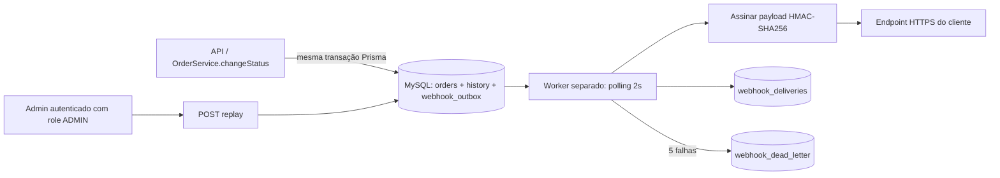

# FDD — Sistema de Webhooks de Notificação de Pedidos

- **Status:** Especificação para revisão técnica
- **Base:** `TRANSCRICAO.md` e código deste fork
- **Escopo:** somente documentação; os caminhos novos abaixo são propostas de implementação, não arquivos já existentes.

## 1. Contexto e motivação técnica

O `OrderService.changeStatus` já executa uma transação Prisma que valida a transição, ajusta estoque quando necessário, atualiza o pedido e cria `OrderStatusHistory`. A feature deve acrescentar o snapshot do evento à mesma transação sem chamar o endpoint do cliente nesse caminho. O processamento HTTP é responsabilidade de um worker separado.

## 2. Objetivos técnicos

- Manter atomicidade entre mudança de status, histórico e registro de evento.
- Evitar dependência síncrona da API em endpoints externos.
- Oferecer configuração por customer/endpoint e filtros por status.
- Entregar eventos assinados, identificáveis e deduplicáveis.
- Permitir retries, DLQ, consulta de histórico e replay administrativo.
- Reutilizar stack e convenções existentes.

## 3. Escopo e exclusões

**Inclui:** CRUD de webhooks, filtro na inserção, outbox, worker, assinatura HMAC, rotação de secret, timeout, retries, DLQ, deliveries, replay admin, métricas/logs.

**Exclui:** e-mail, dashboard visual, rate limiting de saída (fica em observação), exactly-once, worker horizontal inicial e arquivamento automático da outbox.

## 4. Arquitetura proposta



Tabelas são nomes lógicos propostos; o esquema final deve seguir convenções e migrações Prisma do repositório.

## 5. Modelo de dados proposto

Os nomes abaixo são propostas para revisão e não existem ainda no schema atual.

### `webhook_endpoints`

- `id`: UUID.
- `customer_id`: UUID, referência ao customer.
- `url`: URL HTTPS.
- `secret_current`: secret ativa, armazenada com proteção adequada.
- `secret_previous`: secret anterior durante a janela de rotação, se necessário.
- `previous_secret_expires_at`: término da coexistência de 24 h.
- `subscribed_statuses`: conjunto de `OrderStatus` aceitos (a representação física deve ser definida na migração).
- `active`: boolean.
- `created_at`, `updated_at`.

**Segurança:** não registrar secrets em logs nem retornar novamente a secret em listagens/edições. A criação e a rotação retornam a secret apenas no momento em que ela é gerada. O mecanismo de criptografia/gestão de secrets em repouso não foi escolhido na reunião e precisa ser validado antes da implementação.

### `webhook_outbox`

- `id`: UUID (identificador do evento).
- `webhook_id`, `customer_id`, `order_id`.
- `event_type`, `payload_json` (snapshot renderizado no momento da transição).
- `status`: `PENDING`, `PROCESSING`, `DELIVERED`, `FAILED` (nomes propostos).
- `attempt_count`, `next_attempt_at`, `created_at`, `updated_at`.
- Campos operacionais de erro/entrega podem ser definidos em migração; evitar duplicar o histórico completo se ele já ficar em deliveries.

Índices mínimos sugeridos na reunião: status e `created_at`. Rever índices compostos conforme plano de consulta.

### `webhook_deliveries`

Histórico consultável: UUID, webhook/event IDs, status de sucesso/falha, payload enviado, resposta recebida, tempo de resposta e timestamp. A reunião pede esses dados, mas não define retenção nem formato exato da resposta; definir limite de armazenamento e mascaramento de dados durante revisão.

### `webhook_dead_letter`

UUID, referência ao evento original, payload, motivo da falha, timestamp de entrada na DLQ e metadados necessários para replay/auditoria.

## 6. Fluxos detalhados

### 6.1 Criação e validação de configuração

1. Requisição autenticada entra pelo router montado sob `/api/v1`.
2. Validar `customer_id`, URL HTTPS e lista de status via schema Zod.
3. Gerar UUID e secret exclusiva para o endpoint.
4. Persistir configuração ativa e subscriptions.
5. Retornar a configuração e a secret recém-gerada uma única vez.
6. Não registrar a secret em logs.

**Ponto a fechar:** a reunião afirma que `customer_id` é informado no body ou path, não derivado do JWT. A autorização para impedir acesso cruzado a customers precisa ser definida explicitamente antes de implementar CRUD.

### 6.2 Captura de evento na outbox

1. `OrderService.changeStatus` inicia `$transaction`.
2. Lê pedido e status anterior; valida transição e aplica as regras de estoque já existentes.
3. Atualiza `Order` e cria `OrderStatusHistory`.
4. Identifica endpoints ativos do mesmo customer inscritos no status de destino.
5. Para cada endpoint elegível, constrói o snapshot JSON e insere evento na outbox com UUID.
6. Se a inserção de qualquer evento necessário falhar, propaga o erro para a transação fazer rollback.
7. Retorna o pedido atualizado. Nenhuma chamada HTTP é executada aqui.

A função proposta `publishWebhookEvent(tx, order, fromStatus, toStatus)` recebe o transaction client existente. Ela deve usar o `tx` fornecido, nunca criar uma transação separada. A reunião também pede que o evento seja renderizado na inserção, para não refletir alterações posteriores do pedido.

### 6.3 Polling e entrega

1. O processo separado inicializa um `PrismaClient` próprio apontando para o mesmo `DATABASE_URL`.
2. A cada 2 segundos, busca lote pequeno dos eventos pendentes mais antigos, respeitando `next_attempt_at`.
3. Como a decisão inicial é single-worker, processa em ordem de criação. Se houver concorrência acidental ou múltiplas instâncias, a garantia de ordenação deixa de ser confiável; evitar escalar horizontalmente sem nova decisão.
4. Marca o evento como processando de forma consistente para não processar duas vezes dentro do processo.
5. Serializa exatamente o snapshot persistido, verifica o limite de 64 KB e calcula HMAC-SHA256 sobre os bytes exatos enviados.
6. Envia POST HTTPS com timeout de 10 segundos e headers públicos abaixo.
7. Persiste status, payload, resposta e tempo de resposta no histórico.
8. Sucesso HTTP deve ser definido pela equipe na implementação (proposta inicial: qualquer 2xx). Outros status e timeout contam como falha.

### 6.4 Retry e backoff

A reunião definiu a política de cinco tentativas e listou os intervalos 1 min, 5 min, 30 min, 2 h e 12 h, mas não esclareceu se são cinco chamadas totais ou cinco retries adicionais após a inicial, nem como cada intervalo se associa à chamada. Ambas as escolhas permanecem pendentes e devem ser fixadas antes da implementação. A proposta de persistir `next_attempt_at` e deixar o polling retomar eventos é uma decisão de implementação a validar.

### 6.5 DLQ e replay

1. Após esgotar a política, persistir payload, motivo e timestamp na `webhook_dead_letter`.
2. Expor endpoint administrativo `POST /api/v1/admin/webhooks/dead-letter/:id/replay` (path proposto).
3. Exigir role `ADMIN` usando o padrão `requireRole` existente.
4. Registrar ator administrativo, data/hora e ID da dead letter.
5. Recolocar o evento na outbox como pendente. A transcrição não define se o replay preserva o `event_id` original ou cria outro; essa semântica precisa ser decidida antes da implementação.

## 7. Contratos públicos

Os paths abaixo são **propostas de contrato**, porque esses endpoints ainda não existem no código-base. Todos ficam sob o prefixo `/api/v1` já usado pela aplicação.

### 7.1 Criar webhook

`POST /api/v1/webhooks`

Request:
```json
{
  "customer_id": "7d8c4e54-b3d0-4f3d-9e36-7e6b89ef01f1",
  "url": "https://cliente.example.com/hooks/orders",
  "statuses": ["SHIPPED", "DELIVERED"]
}
```

Resposta proposta `201 Created`:
```json
{
  "id": "2abfa5d2-1b30-4d30-8d57-42b3aab6a7c9",
  "customer_id": "7d8c4e54-b3d0-4f3d-9e36-7e6b89ef01f1",
  "url": "https://cliente.example.com/hooks/orders",
  "statuses": ["SHIPPED", "DELIVERED"],
  "active": true,
  "secret": "<mostrar-somente-na-criacao>"
}
```

Erros esperados: `400` para URL/status inválidos, `401` sem autenticação, `403` se política de acesso negar, `409` se regra de duplicidade vier a ser definida. A regra de duplicidade não foi fechada na reunião.

### 7.2 Listar webhooks

`GET /api/v1/webhooks?customer_id=<uuid>`

Resposta proposta `200 OK`:
```json
{
  "items": [
    {
      "id": "2abfa5d2-1b30-4d30-8d57-42b3aab6a7c9",
      "customer_id": "7d8c4e54-b3d0-4f3d-9e36-7e6b89ef01f1",
      "url": "https://cliente.example.com/hooks/orders",
      "statuses": ["SHIPPED", "DELIVERED"],
      "active": true
    }
  ]
}
```

A secret não é retornada em listagens. Paginação não foi definida e fica para revisão.

### 7.3 Atualizar webhook

`PATCH /api/v1/webhooks/:id`

Request:
```json
{
  "url": "https://cliente.example.com/hooks/v2",
  "statuses": ["PROCESSING", "SHIPPED", "DELIVERED"],
  "active": true
}
```

Resposta proposta `200 OK`:
```json
{
  "id": "2abfa5d2-1b30-4d30-8d57-42b3aab6a7c9",
  "url": "https://cliente.example.com/hooks/v2",
  "statuses": ["PROCESSING", "SHIPPED", "DELIVERED"],
  "active": true
}
```

Erros esperados: `400`, `401`, `403`, `404`.

### 7.4 Excluir webhook

`DELETE /api/v1/webhooks/:id`

Resposta proposta `204 No Content`. Eventos já persistidos na outbox e deliveries devem ter política definida para não apagar evidências; recomendação é desativar/impedir novas capturas e manter registros já existentes conforme retenção a definir. O comportamento exato de delete é questão de revisão.

### 7.5 Consultar histórico de entregas

`GET /api/v1/webhooks/:id/deliveries`

Resposta proposta `200 OK`:
```json
{
  "items": [
    {
      "event_id": "a10a8bb9-9fcb-4f9a-885b-7c49dcd9f1e7",
      "status": "FAILED",
      "payload": {
        "event_id": "a10a8bb9-9fcb-4f9a-885b-7c49dcd9f1e7",
        "event_type": "order.status_changed",
        "timestamp": "2026-10-13T14:32:10.000Z",
        "order_id": "8a7e3b52-3dd7-4cbb-8b1d-76b6b44d63d1",
        "order_number": "ORD-000123",
        "from_status": "PROCESSING",
        "to_status": "SHIPPED",
        "customer_id": "7d8c4e54-b3d0-4f3d-9e36-7e6b89ef01f1",
        "total_cents": 12990
      },
      "response_status": 503,
      "response_body": "temporarily unavailable",
      "duration_ms": 10000,
      "created_at": "2026-10-13T14:32:20.000Z"
    }
  ]
}
```

O exemplo é ilustrativo do contrato proposto; paginação, sanitização de response body e retenção devem ser fechadas. A reunião descreve os últimos 100 eventos como caso de uso, mas não fecha query params.

### 7.6 Rotacionar secret

`POST /api/v1/webhooks/:id/rotate-secret` — path proposto, pois o endpoint foi pedido mas o path não foi especificado.

Resposta proposta `200 OK`:
```json
{
  "webhook_id": "2abfa5d2-1b30-4d30-8d57-42b3aab6a7c9",
  "secret": "<nova-secret-mostrar-uma-vez>",
  "previous_secret_valid_until": "2026-10-14T14:00:00.000Z"
}
```

A secret anterior deve ser aceita por 24 horas; após esse prazo não deve validar assinaturas novas. O tratamento de deliveries em andamento durante a rotação deve ser definido na revisão.

### 7.7 Replay de DLQ

`POST /api/v1/admin/webhooks/dead-letter/:id/replay`

Request: sem body obrigatório na proposta inicial.

Resposta proposta `202 Accepted`:
```json
{
  "dead_letter_id": "1b2c3d4e-5f60-4a70-8b90-c1d2e3f4a5b6",
  "status": "QUEUED",
  "replayed_by": "user-uuid"
}
```

Erros esperados: `401`, `403` para usuário sem role ADMIN, `404` se o item não existir. O ator e o momento do replay devem ser auditados.

## 8. Contrato do webhook enviado ao cliente

Payload persistido e enviado:
```json
{
  "event_id": "a10a8bb9-9fcb-4f9a-885b-7c49dcd9f1e7",
  "event_type": "order.status_changed",
  "timestamp": "2026-10-13T14:32:10.000Z",
  "order_id": "8a7e3b52-3dd7-4cbb-8b1d-76b6b44d63d1",
  "order_number": "ORD-000123",
  "from_status": "PROCESSING",
  "to_status": "SHIPPED",
  "customer_id": "7d8c4e54-b3d0-4f3d-9e36-7e6b89ef01f1",
  "total_cents": 12990
}
```

Headers:
- `Content-Type: application/json`
- `X-Event-Id: <UUID do evento>`
- `X-Signature: <assinatura HMAC-SHA256>`
- `X-Timestamp: <timestamp do envio>`
- `X-Webhook-Id: <UUID do endpoint>`

A assinatura é calculada sobre o corpo exato enviado. `X-Timestamp` contém o horário de envio para o consumidor poder avaliar replay, conforme sugerido na reunião; como a assinatura foi definida sobre o corpo, esse header não fica autenticado por ela. O formato textual da assinatura (por exemplo, prefixo `sha256=`) não foi definido e deve ser acordado com os clientes. Se o timestamp também precisar ser autenticado, a composição assinada deve ser decidida antes da implementação.

## 9. Matriz de erros

| Código | HTTP sugerido | Condição | Tratamento |
|---|---:|---|---|
| `WEBHOOK_NOT_FOUND` | 404 | Configuração ou entrega inexistente | Reutilizar `NotFoundError` |
| `WEBHOOK_INVALID_URL` | 400 | URL inválida ou não HTTPS | Validar com Zod |
| `WEBHOOK_SECRET_REQUIRED` | 400 | Operação exige secret ausente | Validar entrada/estado |
| `WEBHOOK_PAYLOAD_TOO_LARGE` | 400/422 | Payload excede 64 KB | Não enviar; registrar falha conforme política |
| `WEBHOOK_DELIVERY_TIMEOUT` | 504 interno / delivery failed | Endpoint excede 10 s | Agendar retry |
| `WEBHOOK_DELIVERY_FAILED` | — | Resposta não considerada sucesso ou erro de rede | Persistir tentativa e retry |
| `WEBHOOK_RETRY_EXHAUSTED` | — | Tentativas esgotadas | Mover para DLQ |
| `WEBHOOK_REPLAY_FORBIDDEN` | 403 | Usuário não é ADMIN | Reutilizar autorização existente |
| `WEBHOOK_INVALID_STATUS_FILTER` | 400 | Status não é um `OrderStatus` válido | Validar com Zod |
| `WEBHOOK_SECRET_ROTATION_FAILED` | 500 | Falha ao persistir rotação | Não expor segredo; registrar erro sem secret |

Os códigos seguem o prefixo `WEBHOOK_` decidido na reunião. O mapeamento exato de HTTP para falhas assíncronas deve ser confirmado com o middleware existente.

## 10. Resiliência

- **Timeout:** 10 segundos por chamada.
- **Retries:** a reunião definiu cinco tentativas e listou os intervalos 1 min, 5 min, 30 min, 2 h e 12 h. Falta decidir se são cinco chamadas totais ou cinco retries além da inicial e como os intervalos correspondem às chamadas.
- **Backoff:** armazenar próximo horário de tentativa, não bloquear o worker dormindo por evento.
- **DLQ:** tabela separada com payload, motivo e timestamp.
- **Fallback:** replay manual via ADMIN; e-mail e automação de replay não fazem parte desta fase.
- **Payload grande:** recusar acima de 64 KB, sem truncar.
- **Duplicatas:** at-least-once; preservar ID estável para deduplicação.
- **Falha na outbox:** rollback da transação principal.
- **Ordenação:** single-worker e ordem por `created_at`; sem promessa de ordering global.

## 11. Observabilidade

### Métricas

- Quantidade de eventos pendentes e idade do evento mais antigo.
- Latência commit → primeira tentativa (p50/p95/p99).
- Taxa de sucesso por endpoint/customer.
- Contagem de timeout, HTTP não exitoso, retries e entradas na DLQ.
- Duração de cada tentativa e tamanho do payload.
- Replay por operador e resultado.

### Logs

Usar Pino existente. Registrar `event_id`, `webhook_id`, `customer_id`, tentativa, duração, status HTTP e código de erro. **Nunca** registrar secret ou assinatura completa. Sanitizar corpos de resposta para evitar vazamento de dados.

### Tracing

A transcrição não decidiu tracing nem identificador de correlação. Como proposta para revisão (não requisito aprovado), pode-se propagar um identificador entre criação do evento, worker, tentativa HTTP e delivery; a instrumentação e o fornecedor precisam ser definidos.

## 12. Dependências e compatibilidade

### Integração com o sistema existente

1. **`src/modules/orders/order.service.ts` — integração crítica.** `changeStatus` usa `this.prisma.$transaction`, valida a transição, ajusta estoque, atualiza `order` e cria `orderStatusHistory`. Inserir o snapshot da outbox usando o mesmo `tx`, depois de determinar `from` e `to`, antes do commit. Não fazer HTTP nessa função.
2. **`src/modules/orders/order.routes.ts` — padrão de rotas.** Usa Express Router, `authenticate` e schemas/`validate`; o módulo novo deve seguir o padrão para endpoints autenticados.
3. **`src/app.ts` — composição de módulos.** `buildControllers` instancia repository/service/controller e `buildApp` monta o router sob `/api/v1`. Registrar as dependências do novo módulo aqui sem alterar os módulos existentes além do necessário.
4. **`src/config/database.ts` — Prisma.** Cria o `PrismaClient` da API. O worker separado deve criar seu próprio client por processo, apontando para o mesmo banco e encerrando a conexão no shutdown.
5. **`src/shared/errors/index.ts` — erros compartilhados.** Exporta `AppError` e erros HTTP como `NotFoundError`, `ConflictError`, `ValidationError` e `ForbiddenError`. Criar erros `WEBHOOK_*` compatíveis com esse padrão e com o middleware.
6. **`src/app.ts` e `src/middlewares/error.middleware.ts` — tratamento centralizado.** A aplicação já instala `errorMiddleware`; verificar seu contrato antes de acrescentar tratamento específico. Evitar um segundo formato de resposta.
7. **`src/shared/logger/index.ts` e `src/server.ts` — logging e entrypoint.** A API usa logger Pino. `src/server.ts` registra handlers para SIGINT/SIGTERM, fecha o servidor HTTP e desconecta o Prisma; o worker deve seguir o logger e tratar os sinais para encerrar seu próprio client.
8. **`prisma/schema.prisma` — dados existentes.** Confirma MySQL, UUIDs em `Char(36)`, enum `OrderStatus`, `Order`, `Customer` e `OrderStatusHistory`. Acrescentar models e relações via migração futura, não alterar o schema neste entregável documental.

### Novos arquivos propostos

- `src/worker.ts` — entry point separado.
- `src/modules/webhooks/webhook.routes.ts`
- `src/modules/webhooks/webhook.schemas.ts`
- `src/modules/webhooks/webhook.controller.ts`
- `src/modules/webhooks/webhook.service.ts`
- `src/modules/webhooks/webhook.repository.ts`
- `src/modules/webhooks/webhook.processor.ts` (ou `webhook.worker.ts`)
- Models de webhook/outbox/deliveries/DLQ em `prisma/schema.prisma`, com migração correspondente.

Esses arquivos são sugestões de estrutura; os arquivos atuais não devem ser alterados como parte deste desafio documental.

## 13. Critérios de aceite técnicos

- Atomicidade da outbox validada por teste de rollback.
- Evento só é inserido para status inscritos por endpoint ativo.
- Snapshot persiste o status e os dados no instante da transição.
- Worker roda separado, usa PrismaClient próprio e polling de 2 segundos.
- URL HTTP recusada, payload acima de 64 KB rejeitado e timeout de 10 s aplicado.
- Assinatura HMAC-SHA256 verificável por exemplo independente, com secret por endpoint e rotação de 24 h.
- Retry, DLQ e replay têm testes de integração.
- CRUD e deliveries respeitam autenticação e escopo de customer aprovado pela equipe.
- Replay exige ADMIN e registra ator.
- Logs não contêm secrets; métricas permitem observar latência e falhas.
